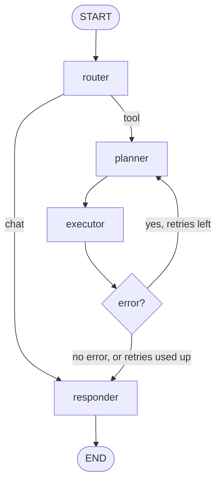
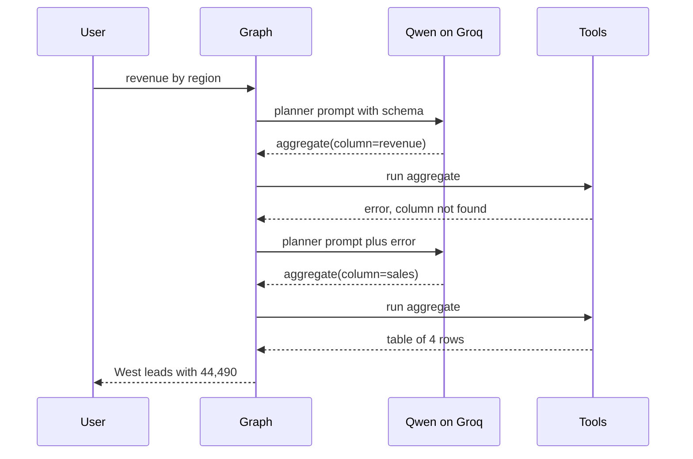

# CSV Analyst Agent

Upload a CSV, ask questions in plain English, get an answer, a table or a chart — and see every step the agent took.

Built with **LangGraph** + **Streamlit**, with the reasoning done by a **Qwen model on Groq**.

> Live demo: _add your Streamlit Community Cloud URL here_

---

## Why this exists

A small, complete example of the skills that matter when building an agent:

- LangGraph routing, shared state, per-session memory, and a bounded retry loop
- A model that is **only allowed to choose a tool and fill JSON arguments** — it never writes pandas code
- Fixed, validated, unit-tested Python tools
- A UI that exposes the trace instead of hiding it
- Tests for the tools, the graph, the UI and the sample data

## How it works



| Node | Job |
|---|---|
| `router` | Reads the question and schema. Picks `tool` or `chat` |
| `planner` | Chooses one tool and returns JSON arguments |
| `executor` | Runs that tool against the dataframe |
| `check` | On error, sends the message back to the planner (max 2 retries) |
| `responder` | Writes the final answer in plain English |

Memory uses LangGraph's `MemorySaver` with one `thread_id` per browser session, so follow-ups like _"now chart that"_ work.

## A conversation, end to end

The bundled `sample_data/sales.csv` has 96 rows and the columns
`date, region, product, rep, units, sales`.

**Q:** "Which region had the highest total sales?"

1. `router` → `tool` — the question needs the data
2. `planner` → `aggregate(group_by="region", column="sales", agg="sum")`
3. `executor` → table with `West 44,490`, `East 23,040`, `South 21,920`, `North 16,740`
4. `check` → valid
5. `responder` → "West had the highest total sales at 44,490."

**Q:** "Show that as a bar chart" → `plot(kind="bar", x="region", y="sales")` → chart + PNG download.

When the planner guesses a column that does not exist, the tool returns a precise error and the graph retries:



## Tools

The model can only ask for these four functions. Arguments are validated before anything runs.

| Tool | Arguments | Returns |
|---|---|---|
| `describe_data` | none | rows, columns, dtypes, missing counts, sample rows |
| `aggregate` | `group_by`, `column`, `agg` | one aggregated value or a grouped table |
| `filter_rows` | `column`, `op`, `value` | matching rows (max 200) |
| `plot` | `kind`, `x`, `y`, `agg` | chart points for bar / line / scatter / hist |

Validation covers: unknown column (with the list of real columns), unknown aggregation, unknown operator, non-numeric column, unknown tool, unexpected keyword arguments. Every failure becomes a message the planner can read on the next attempt.

## Quick start

Requires Python 3.11+.

```bash
git clone <your-repo-url>
cd LangGraphAgent

python -m venv .venv
# Windows
.venv\Scripts\activate
# macOS / Linux
source .venv/bin/activate

pip install -r requirements-dev.txt

cp .env.example .env      # then put your key in GROQ_API_KEY
streamlit run app.py
```

Get a key at [console.groq.com/keys](https://console.groq.com/keys). The default model is `qwen/qwen3.8-27b`; change `GROQ_MODEL` in `.env` to any Qwen model hosted on Groq.

### No key? It still runs

If `GROQ_API_KEY` is empty, the app falls back to a small offline heuristic model (`agent/fake_llm.py`). Routing, tools, retries, tables and charts all work — only the wording is canned. The sidebar shows which mode you are in.

Same thing from the terminal:

```bash
python -m agent.cli sample_data/sales.csv "Which region had the highest total sales?" --demo
```

### Messy CSVs

The loader is deliberately forgiving. It:

- sniffs the delimiter (comma, semicolon, tab, pipe), including `sep=;` written by Excel
- skips title/metadata lines before the real header
- reads UTF-8, cp1252 and latin-1
- keeps values quoted across multiple lines as one row
- skips and counts rows that genuinely do not match the header

The sidebar reports exactly what happened, for example:
`96 rows × 12 columns · semicolon-separated · skipped 2 preamble line(s) · skipped 1 malformed row(s)`.

The suggested questions are generated from the uploaded columns, not hard-coded for the sample.

If a file still cannot be read, the app keeps the previous dataset loaded and shows the first lines it saw.

### Configuration

| Variable | Default | Meaning |
|---|---|---|
| `GROQ_API_KEY` | empty | API key. Empty → offline mode |
| `GROQ_BASE_URL` | `https://api.groq.com/openai/v1` | OpenAI-compatible endpoint |
| `GROQ_MODEL` | `qwen/qwen3.8-27b` | Qwen model id |
| `LLM_TIMEOUT_SECONDS` | `60` | Request timeout |
| `LLM_MAX_TOKENS` | `1024` | Reply budget |
| `MAX_RETRIES` | `2` | Tool-failure retries |

## Tests

```bash
pytest                                   # full suite
pytest -m "not live"                     # skip real API calls
pytest --cov=agent --cov-report=term-missing
```

What is covered:

- **`tests/test_tools.py`** — every tool: happy path, bad column, bad operator, bad aggregation, coercion, JSON-safe output
- **`tests/test_graph.py`** — scripted LLM: tool vs chat routing, retry recovery, retries stopping at 2, unknown tools, no dataframe, LLM outage, memory across turns, responder fallbacks
- **`tests/test_e2e.py`** — six questions against `sample_data/sales.csv`, follow-up context, JSON-safe payloads
- **`tests/test_app.py`** — headless Streamlit runs (`AppTest`): boot, load sample, ask a question, trace panel present
- **`tests/test_llm.py`** — JSON extraction from messy replies, JSON-mode fallback, error wrapping, offline provider choice
- **`tests/test_charts.py`** — PNG export for bar, line, scatter and hist
- **`tests/test_cli.py`** — terminal path, missing file, chart question
- **`tests/test_data.py`** — comma/semicolon/tab parsing, decimal commas, preambles, `sep=` directives, encodings, malformed rows
- **`tests/test_live.py`** — five real Groq calls: totals, chart, file facts, overview, and no silent column substitution; skipped unless `GROQ_API_KEY` is set

CI runs the suite on Python 3.11 and 3.12 (`.github/workflows/ci.yml`).

## Project layout

```
app.py                 Streamlit UI: upload, chat, tables, charts, trace panel
agent/
  graph.py             builds the LangGraph, MemorySaver, run_question helper
  nodes.py             router, planner, executor, check, responder
  tools.py             the four tools + schema builder + validation
  state.py             AgentState and the thread-safe dataframe registry
  llm.py               Groq client, JSON extraction, offline fallback
  data.py              robust CSV loader: delimiter, preamble, encodings, bad rows
  fake_llm.py          heuristic stand-in used without an API key
  config.py            .env settings
  charts.py            plot result -> PNG for download
  cli.py               terminal entry point
tests/                 tools, graph, e2e, app, live
sample_data/sales.csv  96-row demo dataset
.github/workflows/ci.yml
```

## Design decisions

- **No LLM-written code.** The model picks a tool and JSON arguments. This is safer (no arbitrary `exec`), testable (fake LLM), and recoverable (typed errors drive the retry).
- **The dataframe is not in the graph state.** Checkpointing serialises state per thread, so the frame lives in a process-local registry keyed by `thread_id`, and only the text schema travels with the state. This also keeps memory cheap.
- **Retry budget is visible.** `check` writes `retry 1/2` into the trace, and the UI shows the failed attempt, so a recovery is demonstrable rather than magic.
- **Errors are answers, not crashes.** A failed plan after the retry budget produces a friendly message with the last error, never a stack trace.

## Deploy to Streamlit Community Cloud

1. Push the repo to GitHub.
2. On [share.streamlit.io](https://share.streamlit.io), create an app pointing at `app.py`.
3. Add `GROQ_API_KEY = "..."` (and optionally `GROQ_MODEL`) to the app's **Secrets**. `app.py` copies secrets into the environment at startup.
4. Paste the public URL at the top of this README.

## Limitations (and v2)

- One CSV, no joins, no persistence beyond the in-memory session
- `filter_rows` supports single conditions only
- Planned: multiple files, exportable reports, and an evaluation set of questions with expected answers
